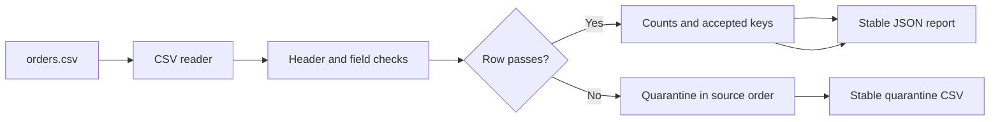

# 05 — System architecture

## Data flow

The CLI reads one source CSV. It checks the header and each record, updates in-memory counters and accepted-key sets, and keeps rejected records in source order. At successful completion it writes one JSON report and one quarantine CSV. The source is read-only.

## Design boundaries

- One command handles one file per run.
- No persistent state is kept between runs.
- Output order follows the input; JSON object keys follow the fixed order in document 08.
- Malformed structure is a command error. Value-quality failures are reportable row rejections.

## ADR questions

1. Why use Python's built-in `argparse` rather than add a CLI package?
2. Why validate trimmed values while preserving original values in quarantine?
3. Why count a row with several value problems once as rejected but count each problem in its own field?

[Back to README](../README.md)
